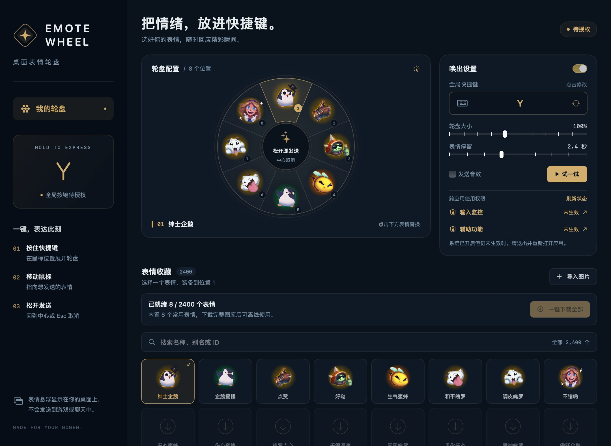

# EmoteWheel · 桌面表情轮盘

按住 **Y**，移动鼠标选择表情，松开后在桌面显示。支持 macOS 和 Windows；快捷键、八个轮盘位置、轮盘大小和停留时间可配置。应用自带 8 张默认表情，其余表情可在配置页一键下载。

本工具在本机显示透明悬浮窗口，**不会向英雄联盟对局、聊天软件或其他玩家发送表情**，也不注入游戏进程。

下面是 macOS 配置界面示意；Windows 使用原生 WPF 界面，核心操作相同。1.3.0 增加了图库下载与进度控制。



## 功能

- 八向轮盘，中心松开取消；展示表情时只有图片，没有圆框或名称。
- 2,400 张英雄联盟 / 云顶之弈表情索引；支持中文、英文、别名和 ID 搜索，包括“弱爆”“流汗”。
- 安装包只带 8 张默认表情；配置页可一键下载完整图库，查看进度、取消或继续下载。
- 已下载图片保存在应用数据目录，更新应用后继续使用；展示已缓存表情无需联网。
- 自定义快捷键、轮盘位置、轮盘大小和表情停留时间；支持导入本地图片，macOS 另有音效选项。
- 识别文本输入焦点，避免中文组字和英文输入 `y` 时打开轮盘。
- 关闭设置窗口后继续运行，通过菜单栏 / 系统托盘打开设置或退出。

## 下载与运行

可在本仓库 **Actions → Build → 成功的工作流运行 → Artifacts** 下载对应平台的压缩包。自动构建只产生下载文件，不会自动发布 Release。

| 平台 | 要求 | 运行方式 |
| --- | --- | --- |
| macOS Apple Silicon | macOS 13 或更新版本 | 解压 `EmoteWheel-macOS-arm64.zip`，将 `EmoteWheel.app` 放入“应用程序”后打开 |
| macOS Intel | macOS 13 或更新版本 | 使用 `EmoteWheel-macOS-x86_64.zip` |
| Windows x64 | Windows 10 / 11 | 解压整个 `EmoteWheel-windows-x64.zip`，打开其中的 `EmoteWheel.exe`；请保留同目录所有文件 |

Windows 包包含 .NET 运行时，用户无需另装 .NET。Windows 版目前未完成 Windows 实机交互验收；构建成功不能替代实际多屏、输入法及其他应用兼容性测试。

### 下载完整图库

首次打开可直接使用 8 张默认表情。需要更多表情时，在配置页点击“下载全部表情”。完整图库的原始素材约 199 MiB；CDN 压缩后的实际下载流量可能更小。应用会显示进度，允许取消；再次下载时跳过已经缓存的图片，失败后可以重试。

下载只在主动点击后开始，不要求账号。图片下载并成功解码后保存在下面的数据目录；更新应用或关闭设置不会清空缓存。没有网络时仍可使用默认表情和此前下载的图片。

### macOS 权限

1. 在配置页分别点击“输入监控”和“辅助功能”按钮。
2. 在系统设置 → 隐私与安全性中开启对应的 EmoteWheel 开关。如果没有应用条目，用 `+` 添加 `/Applications/EmoteWheel.app`。
3. 按系统提示彻底退出并重新打开应用。关闭设置窗口不会退出应用，请使用菜单栏中的“退出”。
4. 返回配置页检查状态，必要时点击“刷新状态”。

输入监控用于接收全局按键；辅助功能用于判断当前焦点是不是可编辑控件。未获得这两项权限时，可通过配置页的“试一试”预览轮盘。

**为什么更新后可能需要重新授权？** 默认构建使用 ad-hoc 临时签名。macOS 的隐私授权会校验应用签名，重新构建或更换资源后旧授权可能不再匹配；保持名称、安装路径和 Bundle ID 本身不能解决签名身份变化。如果开关已开但应用仍显示未生效，先完全退出再重开；仍有问题时，在两项权限列表中移除旧条目，然后重新添加当前应用。

要让正式更新通常能够继承权限，需要保持 `studio.emotewheel.desktop` 这个 Bundle ID，并持续使用同一开发者签名身份。目前项目没有 Developer ID 证书或 Apple 公证；默认构建仍可能要求重新授权。源码构建支持 `SIGNING_IDENTITY`，见下文。系统行为还会受签名要求、安装方式及系统策略影响，不能保证所有更新永远不再询问。

下载的未公证应用可能被 Gatekeeper 提醒。确认文件来源后，可以在 Finder 中右键“打开”，或按 macOS“隐私与安全性”页面提示处理。无需关闭系统安全机制。

### Windows 权限

Windows 版使用系统键盘钩子与 UI Automation，不需要 macOS 的“输入监控 / 辅助功能”授权。普通桌面应用下直接运行即可；管理员窗口、安全桌面和部分独占全屏程序可能限制输入焦点识别或悬浮窗口。不要为规避这些限制默认使用管理员身份运行。

## 操作与配置

1. 点击轮盘上的一个位置，再点击图库中的表情，替换该位置。
2. 在非文本输入区域按住 **Y**，移动鼠标指向目标，松开 **Y** 显示表情。
3. 在中心松开、按 Esc 或鼠标右键可取消。
4. 点击快捷键设置并录入新的按键；可组合 Control / Alt（Option）/ Shift 等修饰键。macOS 还支持 Command。
5. 搜索栏支持名称、别名或 ID。例如 `弱爆` 找到两张图，`流汗` 找到三个相关结果，`3239` 找到带中文字的“弱爆”。
6. “导入图片”将图片保存在应用自己的数据目录中；动画格式按静态图片处理。
7. 调整轮盘大小和展示时间；macOS 可开关音效。恢复默认会重置快捷键与轮盘，但保留已导入图片。

按键采用被动监听，原始按键仍会传给当前软件。如果 Y 与前台软件功能冲突，可以改为组合键。

### 配置与隐私

| 平台 | 设置与导入文件 |
| --- | --- |
| macOS | `~/Library/Application Support/EmoteWheel/`，包含 `settings.json`、`imports/` 和图库缓存 `emotes/` |
| Windows | `%LOCALAPPDATA%\EmoteWheel\`，包含 `settings.json`、`imports\` 和图库缓存 `emotes\` |

两端独立保存设置；系统键码和修饰键不同，不支持直接交换配置文件。更新时不覆盖该数据目录。

应用没有遥测、登录、聊天发送或上传功能。键盘监听只用于匹配快捷键；焦点检查读取控件类型、编辑能力等元数据，不读取输入框中的文字。只有主动下载图库时会请求 CommunityDragon 的公开图片地址，不会上传配置、按键或输入内容。

输入保护依赖前台软件暴露的可编辑状态；中文和英文共用同一焦点判断。未暴露编辑状态的自绘编辑器、游戏、特殊终端，以及无法访问的控件，需要实际验证。macOS 在无法可靠识别焦点时暂停快捷键。系统安全输入、保留快捷键和受保护全屏画面也可能限制行为。

## 从源码构建

克隆仓库后可直接构建，无需先下载完整图库。源码包含 8 张默认图片、2,400 条表情索引和来源清单；标准构建只打包这 8 张图片。macOS 和 Windows 应用均可在运行后下载其余图片。

### macOS

安装 Xcode Command Line Tools 后构建：

```bash
xcode-select --install
bash build.sh
```

默认生成 `dist/EmoteWheel.app`，架构与当前 Mac 一致。脚本在 `.build/` 中保存编译缓存，并将默认图片打包到应用的 `Resources/emotes/` 目录。

```bash
# 指定架构；可在配有 macOS SDK 的 Mac 上交叉编译
ARCH=arm64 bash build.sh
ARCH=x86_64 bash build.sh

# 自定义输出目录（相对仓库根目录或绝对路径）
OUTPUT_DIR=/tmp/emotewheel-build bash build.sh

# 使用本机钥匙串中已有的 Developer ID 证书
SIGNING_IDENTITY='Developer ID Application: Your Name (TEAMID)' bash build.sh
```

默认 `SIGNING_IDENTITY=-` 表示 ad-hoc 签名。指定证书后会启用 hardened runtime 和时间戳，但脚本**不负责公证或安装证书**。公开分发时可另外使用 Apple 的 notarization 流程；不要将证书、私钥或密码提交到仓库。

### Windows

需要 [.NET 8 SDK](https://dotnet.microsoft.com/download/dotnet/8.0)。在仓库根目录使用 PowerShell：

```powershell
dotnet publish Windows/EmoteWheel.csproj -c Release -r win-x64 --self-contained true -o dist/EmoteWheel-windows-x64
```

运行 `dist/EmoteWheel-windows-x64/EmoteWheel.exe`。分发时压缩整个输出目录，不要只复制 EXE。在 macOS / Linux 上交叉构建时，追加 `-p:EnableWindowsTargeting=true`；WPF 应用只能在 Windows 运行。

### 可选：下载素材归档

开发者如需单独保存和严格校验全部素材，可使用 Python **3.10 或更新版本**和 Pillow 运行下面的脚本。它将图片写入源码目录的 `Resources/emotes/`，不改变标准安装包只携带 8 张图片的行为；普通用户直接使用应用内的下载按钮即可。

```bash
python3 -m pip install -r scripts/requirements.txt
python3 scripts/download_emotes.py
python3 scripts/download_emotes.py --verify-only
```

Windows PowerShell 中可将 `python3` 换成 `py -3`。默认并发 8，可用 `--workers 4` 降低并发。已通过校验的图片会跳过，失败可重试；`--verify-only` 不访问网络。Pillow 仅用于这个开发工具，应用自身不依赖 Python 或 Pillow。

归档脚本先检查原始 PNG 的 SHA-256。CommunityDragon 的 CDN 可能重新压缩 PNG，并改变完全透明像素中不可见的 RGB 值；文件哈希不匹配时，脚本检查尺寸和规范化 RGBA 像素哈希，仅将 alpha 为 0 的像素 RGB 归零，可见像素和 alpha 必须完全一致。上游实际图像变化时校验仍会失败，不会自动接受新素材。应用内下载则检查 PNG 是否能成功解码，不使用这套归档哈希检查。

### 测试

素材下载器的回归检查覆盖 CDN 优化后的图像校验：

```bash
python3 -m pip install -r scripts/requirements.txt
python3 -m unittest discover -s scripts/tests
```

macOS 的基础与焦点回归检查：

```bash
bash scripts/test_macos.sh
```

原生交互检查需要可用的 macOS 图形会话，不会申请全局键盘权限、读取用户配置或保存设置：

```bash
bash scripts/test_macos.sh --native
```

开发预览 / 截图模式同样不申请权限、不保存配置：

```bash
dist/EmoteWheel.app/Contents/MacOS/EmoteWheel --preview
dist/EmoteWheel.app/Contents/MacOS/EmoteWheel --capture /tmp/emotewheel-preview
```

macOS 检查覆盖几何与配置、焦点分类和原生交互，包括英文输入、中文 marked text、重复按键、可编辑祖先和松键前焦点变化。跨应用快捷键实测仍依赖系统授权；这些自动检查不代表每个第三方应用均兼容。

Windows 版已完成 win-x64 自包含交叉编译（0 警告、0 错误）和 19 项几何、配置、搜索检查；实际多应用、输入法、多屏交互仍待 Windows 验证，具体步骤见 [Windows/TESTING.md](Windows/TESTING.md)。

Windows 几何与配置检查可以跨平台运行：

```bash
dotnet run --project Windows/Tests/CoreTests.csproj -c Release
```

在 Windows 上可以额外检查应用是否能读取图库索引并解码内置图片，不监听全局按键、不修改用户设置：

```powershell
$process = Start-Process dist/EmoteWheel-windows-x64/EmoteWheel.exe -ArgumentList '--self-test' -Wait -PassThru
if ($process.ExitCode -ne 0) { throw "EmoteWheel self-test failed: $($process.ExitCode)" }
```

### GitHub Actions

`.github/workflows/build.yml` 在推送、Pull Request 或手动运行时：

- 运行可选素材归档工具的回归检查，不下载完整图库。
- 在 macOS runner 运行基础 / 焦点检查，构建 arm64 和 x86_64 应用。
- 运行 Windows 核心检查，在 Windows runner 构建包含运行时的 x64 应用，并执行索引与默认图片加载检查。
- 两个平台都只打包 8 张默认图片；完整图库由用户在应用内按需下载。
- 打包为 ZIP 并上传工作流 Artifacts，保留 14 天。

CI 没有配置 Apple / Windows 发布证书，产生的 macOS 包使用 ad-hoc 签名，Windows 包未做 Authenticode 签名。CI 不会触发实际全局按键、操作系统权限弹窗或更改用户设置。

## 项目结构

```text
Sources/                  macOS：Swift / AppKit / SwiftUI
Tests/                    macOS 几何、配置、焦点与原生交互检查
Windows/                  Windows：C# / WPF
Resources/emotes.json      两端共用的表情名称、别名和文件名
Resources/emotes-sources.json  图片来源 URL 与 SHA-256
Resources/starter-emotes/  安装包自带的 8 张默认 PNG
Resources/emotes/          可选素材归档（不进入 Git，不随标准构建打包）
scripts/download_emotes.py 可选素材归档与严格校验
scripts/test_macos.sh      macOS 测试入口
build.sh                  macOS 编译和签名
.github/workflows/build.yml 自动构建
SOURCES.md                素材来源与版权说明
```

macOS 中，`WheelMath.swift` 负责配置与几何，`AppModel.swift` 负责图库与存储，`KeyboardController.swift` 负责快捷键与权限，`TextInputFocus.swift` 负责焦点识别，`Overlay.swift` 负责透明窗口与动画，`SettingsView.swift` 负责配置界面。

## 问题排查

- **关闭设置后按 Y 没反应**：先确认应用仍在菜单栏 / 托盘运行且未暂停；点击非编辑区域；检查快捷键配置。macOS 还要确认两项权限均已生效。
- **浏览器或其他软件里有时不触发**：输入框、搜索框、密码框和可识别编辑器内本来就应暂停；检查焦点是否仍停留在编辑控件。特殊自绘 UI 可能无法可靠识别。
- **更新后 macOS 显示未授权**：参照上方权限步骤重新添加当前 `/Applications/EmoteWheel.app`。反复重编译 ad-hoc 包无法保证复用授权。
- **有名称但没有图片**：点击“下载全部表情”，等待对应图片下载完成；取消或失败后可再次下载，已缓存图片会保留。
- **默认图片无法显示**：完整解压安装包并保留 `Resources` 目录；源码构建时检查 `Resources/starter-emotes/` 是否包含 8 张 PNG。
- **Windows 无法启动**：确认系统为 Windows 10 / 11 x64，完整解压发布目录；不要从 ZIP 内直接运行或只拷贝 EXE。

## 素材与权利

表情图片来自 CommunityDragon 镜像中的 Riot 游戏资源，权利归 Riot Games 及相应权利人所有。项目非官方、与 Riot Games 无关联、未获其背书；没有把第三方素材声明为本项目所有或授予其再分发许可。详细来源、索引和排除项见 [SOURCES.md](SOURCES.md)。

本仓库暂未选择源码开源许可证；公开可见不等于已授予开源许可证。第三方素材与源码的许可应分别处理。
